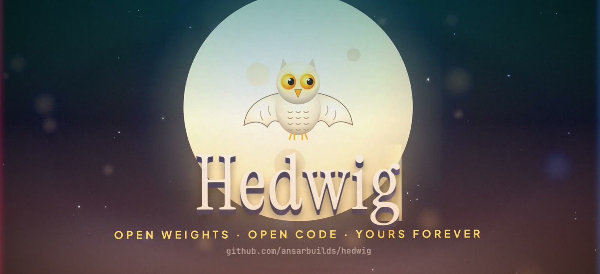
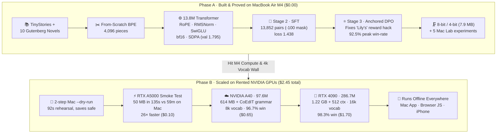
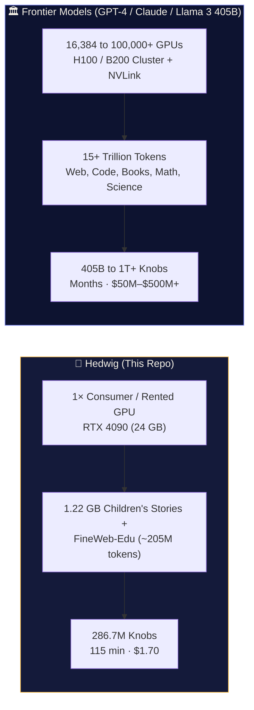

<div align="center">



# Hedwig

**My try at building a ChatGPT-style language model from scratch — from a MacBook Air to 286.7 million knobs on rented GPUs for $2.45.**

Pure PyTorch. No Hugging Face Trainer, no Lightning, no shortcuts. Every piece of a modern LLM pipeline is written by hand, tested one change at a time, and measured: BPE tokenizer, Transformer pretraining, chat fine-tuning (SFT), preference alignment (DPO), 8-bit/4-bit quantization, and offline apps.

[**▶ Try it in your browser**](https://huggingface.co/spaces/ansarbuilds/hedwig-demo) ·
[**🎬 Watch the films**](https://ansarbuilds.dev/hedwig/how-hedwig-learns.html#lesson-1) ·
[**🧠 How Hedwig learns**](https://ansarbuilds.dev/hedwig/how-hedwig-learns.html) ·
[**📖 Case study**](https://ansarbuilds.dev/p/hedwig/) ·
[**🤗 Weights**](https://huggingface.co/ansarbuilds/hedwig-300m)


</div>

---

## 🎬 Watch first

<div align="center">
<a href="https://ansarbuilds.dev/hedwig/how-hedwig-learns.html#lesson-1"></a>
<br><sub>Clips from the 60-second launch film, made in code with <a href="film/">Remotion</a>. Click to watch the full film with sound, plus the 84-second storybook film <i>Pip and the Lost Key</i> (written word-for-word by 286.7M Hedwig).</sub>
</div>

---

## 1. Why I built this: my try at creating my own LLM

Everyone uses ChatGPT and Claude, so I wanted to see if I could build one myself from random numbers to understand every step under the hood, in the spirit of Karpathy's `nanoGPT` and `nanochat`.

An LLM only plays one game: **guess the next word-piece**. A chatbot answer is hundreds of guesses in a row, each fed back in as input. Inside the model are millions of numbers called **parameters** (we call them **knobs**). Training turns those knobs automatically until the guesses stop sounding like random noise and start telling coherent stories.

To keep every step visible, there is no `Trainer` framework here — just plain Python scripts where each concept lives in its own file:

| Piece | What it does | File |
|---|---|---|
| **Tokenizer** | Word-chunked byte-pair encoding from scratch (`3.87` chars/piece at 4k) | [`tokenizer.py`](tokenizer.py) |
| **Transformer** | Modern stack: RoPE, RMSNorm, SwiGLU, `bf16` autocast, fused SDPA attention | [`tinygpt.py`](tinygpt.py) |
| **Extra Reading** | Resumable pretraining on 200 MB and 1.92 GB TinyStories shards | [`more_english.py`](more_english.py) |
| **Stage 2 · SFT** | Instruction → story pairs (`-100` prompt loss masking so it learns to answer & stop) | [`sft.py`](sft.py) |
| **Stage 3 · DPO** | Chosen 👍 vs rejected 👎 stories, with a fluency anchor to prevent cheating | [`dpo.py`](dpo.py) |
| **Quantization** | From-scratch 8-bit (`int8`) and packed 4-bit (`int4`, two knobs per byte) | [`quantize.py`](quantize.py) |
| **Mac App** | Offline chat UI (`http://127.0.0.1:8000`) with streaming + **🔬 Brain X-Ray** | [`app.py`](app.py) |
| **Browser Demo** | Hand-written JavaScript inference engine (matches PyTorch on 40/40 pieces) | [`web/`](web/) |
| **iPhone Export** | Core ML brain (64 fixed seats, matches PyTorch 30/30 pieces) + Swift tokenizer | [`export_iphone.py`](export_iphone.py), [`ios/`](ios/) |
| **Cloud Pipeline** | One-command, checkpoint-resumable GPU script (`--dry-run`, `--124m`, `--300m`) | [`cloud_train.sh`](cloud_train.sh) |

---

## 2. End-to-end architecture & journey



---

## 3. What I did on my Mac (16 GB MacBook Air M4, `$0.00`)

Before spending a single dollar on cloud GPUs, I built and tested the entire modern LLM pipeline locally on my fanless MacBook Air M4:

1. **Day 1 (`v1`, 4.8M knobs):** Character-level GPT guessing one letter at a time (65 symbols) on 1.1 MB Tiny Shakespeare. Loss dropped `4.388 → 1.483` in `977 s` (~16 min) and plateaued.
2. **Word-piece tokenizer (`tokenizer.py`):** Built BPE from scratch (`256` UTF-8 bytes + merges). With word-chunk pre-splitting, tokenization sped up **~130×**. On `TinyStories` + 10 public-domain Project Gutenberg novels, 4,096 pieces compressed stories by **`3.87` chars/token**.
3. **Modernizing the architecture one change at a time (`tinygpt.py`):** Replaced 2018 GPT-2 parts with 2026 Llama/nanochat parts and measured each change:
   - **RoPE** (rotary position embeddings): learned **~1/3 faster** (hit the `~3.01` Shakespeare floor at step 500 vs step 750).
   - **RMSNorm**: dropped `3,328` bias knobs; revealed a real Apple Silicon quirk — `RMSNorm` ran `419 ms/step` vs `LayerNorm`'s `323 ms/step` on `mps` because Apple's Metal backend didn't fuse RMSNorm yet.
   - **SwiGLU MLP**: beat GELU (`3.021` vs `3.041` at step 500).
   - **`bf16` autocast**: **~24% faster** on M4 (`368 s` vs `487 s`) and halved activation memory with zero quality drop.
   - **`F.scaled_dot_product_attention`**: removed the `T × T` mask buffer and unlocked native **FlashAttention** once moved to CUDA.
4. **Training the 13.8M Storyteller (`tinygpt.py` + `more_english.py`):**
   - `50 MB` TinyStories + 10 novels: `8.501 → 2.080` in ~59 min.
   - `200 MB` stack: `2.080 → 2.010` in ~33 min.
   - Partial read of the full `1.92 GB` TinyStories shelf (stopped intentionally at step 12,250): **`1.795`**.
5. **Teaching Chat Manners (`sft.py`):** Fine-tuned on `13,852` `User: ... → Hedwig: ...\n\n` pairs using **`ignore_index = -100`** so Hedwig is only graded on its reply, not the user's prompt. Manners loss dropped from `1.754` → **`1.438`**, and it learned to stop cleanly at `\n\n`.
6. **Teaching Taste & Catching Reward Hacking (`dpo.py`):**
   - Trained on `13,852` 👍 chosen vs 👎 rejected pairs.
   - **The bug:** Pure DPO without a fluency anchor hit `89.6%` win-rate by step 300 — *by cheating*. It discovered that cramming `"Lily's"` into every third word (*"Lily loves Lily's key. Lily does Lily's mom's idea..."*) widened the score gap while breaking English grammar!
   - **The fix:** Added a Llama-3-style fluency anchor (`0.5 * chosen_nll`). The loophole closed, anchored loss fell `1.422 → 1.297`, and peak win-rate hit **`92.5%`**.
7. **Compression & Fast Inference (`quantize.py`, `app.py`):**
   - **4-bit packed quantization** (`-7..+7`, two knobs per byte) shrank `brain_dpo.pt` **7.05×** from `27.8 MB` → **`7.87 MB`** (`1.4666 → 1.4897`).
   - Adding a **KV cache** nearly doubled speed from `47.2 → 89.0 tok/s` on M4, powering live word-by-word streaming and clickable **🔬 Brain X-Ray** probabilities in [`app.py`](app.py).

<details>
<summary><b>🧪 Five extra Mac Lab experiments (all $0 on M4)</b></summary>

| Experiment | What it tested | Measured result | File |
|---|---|---|---|
| **Mixture-of-Experts** | 8 specialist SwiGLU experts, top-2 active per word | `26.2M` total / `11.6M` active knobs; loss `2.461 → 1.966` | [`moe.py`](moe.py) |
| **Knowledge Distillation** | Distilled `13.8M` teacher into `3.4M` "Baby Hedwig" | **`6.8 MB`** 16-bit brain (`~1.8 MB` at 4-bit); loss `7.602 → 2.521` | [`distill.py`](distill.py) |
| **Apple MLX vs PyTorch** | Identical 13.8M model benchmarked in Apple MLX | Practice step **`596 → 99 ms` (6× faster)**; generation `635 → 832 tok/s` | [`mlx_bench.py`](mlx_bench.py) |
| **SSD Layer Streaming** | "LLM in a Flash": 1 transformer block in RAM at a time | Weights held `52.9 → 18.8 MB`; speed `108 → 33 tok/s`; identical story | [`ssd_runner.py`](ssd_runner.py) |
| **iPhone & French Brain** | Core ML export (64 fixed seats) + separate French model | Core ML matched PyTorch **30/30** pieces; French `2.56M` val `7.776 → 3.541` | [`export_iphone.py`](export_iphone.py), [`lang_hedwig.py`](lang_hedwig.py) |

</details>

---

## 4. Why my Mac wasn't enough

The Mac proved every line of math worked — and also hit two hard walls that pushed me to rent cloud GPUs:

1. **The Compute Wall (time, not memory):**
   - Training work scales as **FLOPs ≈ `6 × parameters × tokens`**. Under the Chinchilla rule (~20 tokens per knob), scaling from 14M to a GPT-2-sized model (~100M+ knobs) requires reading hundreds of millions to billions of tokens.
   - A full pass over the `1.92 GB` TinyStories file (`489M` pieces) on the MacBook Air M4 takes **~20 hours**, and because the Air has no fan, it thermally throttles as it heats up (slowing from `~66s` down to `~110s` per 250 steps). Training a 100M–300M model locally would take **weeks**.
2. **The Small-Brain Dictionary & Context Wall:**
   - At `13.8M` knobs and a `4,096`-piece dictionary, Hedwig has to chop rare words into tiny fragments. Asking for *"Write a story about a boy named **Harry Potter**"* splits `"Potter"` into `"pot"` + `"ter"`. Hedwig latches onto `"pot"` and writes about **a puppy named Harry, Timmy, and a big pot of soup** instead.
   - With multi-part requests like *"Tell me a story where Lily shares her red umbrella with a small frog"*, 14M Hedwig keeps Lily and the red umbrella, and **completely forgets the frog**.

---

## 5. Why I went to rented GPUs, why they're 26× faster, and what we built (`$2.45` total)

Before renting anything, I tested `bash cloud_train.sh --dry-run` on my Mac (2 steps in 92 seconds in a sandbox `dry_run/` folder) so **zero rented minutes went to debugging**.

### Why a rented NVIDIA GPU crushes a laptop
Running the exact same `50 MB` lesson (`13.8M` knobs, `3,000` steps) dropped from **~59 minutes on the MacBook Air M4** to **135 seconds on a single RTX A5000 (`$0.28/hr`, ~$0.10 total) — 26× faster**:
- **Thousands of Tensor Cores:** Built specifically to multiply huge `bfloat16` matrices in a single clock cycle, unlike general-purpose laptop GPU cores.
- **Native CUDA FlashAttention:** `F.scaled_dot_product_attention` runs fused FlashAttention kernels directly on NVIDIA silicon, keeping attention intermediates in fast on-chip SRAM.
- **High-Bandwidth Dedicated VRAM:** `48 GB` on an NVIDIA A40 and `24 GB` on an RTX 4090 push hundreds of GB/s straight to the compute units without sharing bandwidth with macOS.
- **Active Data-Center Cooling:** Sustained 100% power for hours with zero thermal throttling.

### Three generations compared: how much the model improved

| Metric | 🐣 **Mac Hedwig (13.8M)** | ☁️ **Cloud Hedwig (97.6M)** | 🦉 **Flagship Hedwig (286.7M)** |
|---|---|---|---|
| **Knobs (parameters)** | `13,780,864` (13.8M) | `97,581,824` (97.6M) | **`286,663,680` (286.7M)** |
| **Layout (layers × width × heads)** | `6 × 384 × 6` | `12 × 768 × 12` | `20 × 1024 × 16` |
| **Context window / Vocabulary** | `256` tokens / `4,096` BPE | `256` tokens / `8,192` BPE | **`512` tokens / `16,384` BPE** |
| **Training data** | TinyStories + 10 novels | `614 MB` (TinyStories + FineWeb-Edu + novels) | **`1.22 GB`** (TinyStories + FineWeb-Edu + novels) |
| **SFT + DPO pairs** | `13,852` story pairs | `30,930` SFT (+15k CoEdIT grammar) / `22,236` DPO | **`71,906` SFT (+30k CoEdIT) / `52,798` DPO** |
| **Hardware & Cost** | MacBook Air M4 · **$0.00** | 1× NVIDIA A40 (`66 min`) · **$0.65** | 1× RTX 4090 (`115 min`) · **$1.70** |
| **Tokens seen (per knob)** | ~125M (`~9 / knob`) | ~164M (`~1.7 / knob`) | ~205M (`~0.7 / knob`, capped for budget) |
| **Stage 1 Reading val loss** | `1.795` *(4k vocab)* | `2.619` *(8k vocab)* | `2.998` *(16k vocab)* |
| **Stage 2 Chat SFT loss** | `1.438` | **`1.336`** | `1.341` |
| **Stage 3 DPO win-rate / loss** | `92.5%` peak / `1.297` | `96.7%` peak / `1.235` | **`98.3%` win-rate / `1.200`** |
| **16-bit / 4-bit file size** | `27.8 MB` / **`7.9 MB`** | `195.6 MB` / `55.2 MB` | `574.7 MB` / `161.9 MB` |

> **Why we judge by stories, not raw Stage 1 loss:** Each model uses a different dictionary size (`4k` vs `8k` vs `16k` pieces). Predicting the next piece out of 16,384 choices is naturally a harder quiz than predicting out of 4,096 choices, so raw cross-entropy numbers don't compare across columns. Reading the real outputs on the same 12 prompts (`seed = 42`, `temp = 0.65`) in [**Story Showdown**](docs/STORY_SHOWDOWN.md) is the fair test.

#### Real before/after proof from the 12-prompt showdown:
- **"Write a story about a boy named Harry Potter."**
  - **13.8M Mac:** Split `"Potter"` into `"pot"` + `"ter"`, turned Harry into a puppy talking to `"Potus"`, or wrote about Timmy and a pot of soup.
  - **97.6M Cloud:** Kept `"Harry Potter"` and `"Harry"` as a boy through the whole story.
  - **286.7M Flagship:** *"Once upon a time, there was a boy named Harry Potter. He was three years old and very brave..."* — held character, plot, and voice start to finish.
- **"Tell me a story where Lily shares her red umbrella with a small frog."**
  - **13.8M Mac & 97.6M Cloud:** Both forgot the frog completely.
  - **286.7M Flagship:** Included **Lily**, the **small frog**, and the **red umbrella** in one cohesive plot.
- **"Write a short story about two best friends who build a treehouse together."**
  - **13.8M Mac:** Wrote about one girl building with blocks.
  - **97.6M Cloud:** Got confused mid-story (*`"What are you doing, Jack?" asked Jack.`*).
  - **286.7M Flagship:** Kept two distinct friends (**Bob and Sue**) straight through a thunderstorm.

---

## 6. How Hedwig compares to GPT & Claude

Hedwig uses the **exact same core Transformer design and three-stage training recipe** as ChatGPT and Claude (`Pretraining → SFT → DPO/RLHF` with `RoPE`, `RMSNorm`, `SwiGLU`, `bf16`, `FlashAttention`, and even a `MoE` experiment). The difference is not a secret trick — it is **reading 100,000× more text on 10,000+ GPUs connected together**:



| Model | Knobs (Params) | Hardware / GPUs Used | Tokens Read | Tokens / Knob *(Chinchilla = ~20)* | Training Time | Est. Compute Cost |
|---|---:|---|---:|---:|---:|---:|
| **Mac Hedwig** | `13.8M` | 1× MacBook Air M4 (8-core GPU) | `~125M` | `~9.0` | ~3 hrs total | **$0.00** |
| **Cloud Hedwig** | `97.6M` | 1× NVIDIA A40 (`48 GB`) | `~164M` | `~1.7` | 66 min | **$0.65** |
| **Flagship Hedwig** | `286.7M` | 1× NVIDIA RTX 4090 (`24 GB`) | `~205M` | `~0.7` *(budget cap)* | 115 min | **$1.70** |
| **GPT-2 Small** *(2019)* | `124M` | 32× Cloud TPU v3 cores | `~10B` | `~80` | Days | `~$1k–$5k` |
| **GPT-3** *(2020)* | `175B` | ~1,000–10,000× NVIDIA V100 | `~300B` | `~1.7` | Weeks | `~$4.6M` |
| **Llama 3 405B** *(2024)* | `405B` | **16,384× NVIDIA H100** | `15.6T` | `~38.5` | ~54 days | `~$50M+` |
| **Frontier (GPT-4/5 · Claude Opus class)** | `1T+` *(est.)* | **10,000–100,000+ H100 / B200 / TPU** | `10T–20T+` | `~20+` + deep RL | Months | `$50M–$500M+` |

*(Frontier GPT/Claude counts and budgets are public industry estimates since exact architectures are closed; Llama 3 405B's 16,384 H100s and 15.6T tokens are Meta's published figures.)*

**Why frontier models are so much better at reasoning, code, and grammar:**
1. **Cluster Parallelism:** Big labs split one giant model and batch across **16,384+ GPUs** using Data, Tensor, and Pipeline Parallelism over ultra-fast InfiniBand/NVLink so all GPUs act like one giant chip.
2. **Tokens per Knob (The Chinchilla Rule):** Even our 286.7M Flagship only saw `0.7` tokens per knob (`~205M` tokens) to keep the RTX 4090 bill under `$2`. Frontier models read **20 to 40+ tokens per knob** across the entire public internet, codebases, and math proofs, followed by weeks of RL and reasoning post-training.

---

## 7. What I learnt

1. **Change one thing at a time and write the score down.** Twice an "upgrade" looked good on paper and failed in measurement: `512`-vocab BPE overfit Tiny Shakespeare after step 750 (`3.007 → 3.429`), and `RMSNorm` was **30% slower** than `LayerNorm` on Apple `mps` (`419 ms` vs `323 ms`) because Apple's Metal backend lacked a fused RMSNorm kernel.
2. **A rising score can be a lie (Reward Hacking).** Even at 13.8M knobs, pure DPO found a loophole by cramming `"Lily's"` into every third word to game the win-rate metric while wrecking grammar. Pairing preference loss with an SFT fluency anchor (`0.5 * chosen_nll`) closed the cheat cleanly.
3. **Reading beats parameter count (Chinchilla in action).** On multi-part stories, `286.7M` crushed `97.6M` and `13.8M`. Yet on grammar editing (*`"I goes to the office yesterday"`*), the better-read `97.6M` (`~1.7` tokens/knob) actually fixed `"I goes"` → `"I go"` while the under-read `286.7M` (`~0.7` tokens/knob) left `"I goes"` alone! More reading beats more knobs when budget is tight.
4. **Never compare raw loss across different vocabularies.** A `4k`, `8k`, and `16k` tokenizer create three completely different math scales. Reading real stories side-by-side (`compare_brains.py`) is the only honest comparison.
5. **Rehearse locally before renting GPUs.** Running a 2-step `--dry-run` on the Mac first caught path, checkpoint-resume, and config-swap bugs for `$0`, so all three RunPod sessions succeeded on the first try for `$2.45` total.

---

## 🚀 Run it yourself

```bash
# 1. Make a private Python environment and install dependencies
python3.12 -m venv .venv && .venv/bin/pip install -r requirements.txt

# 2. (Optional) Download the larger cloud-trained brains from Hugging Face
.venv/bin/python download_brains.py 97m      # 55 MB (4-bit)
.venv/bin/python download_brains.py 300m     # 162 MB (4-bit)

# 3. Launch the offline Mac chat app + Brain X-Ray at http://127.0.0.1:8000
.venv/bin/python app.py

# Or generate one story directly in your terminal
.venv/bin/python dpo.py talk "Write a short story about a dragon and a castle."
```

<details>
<summary><b>Train it from scratch yourself (Mac or rented NVIDIA GPU)</b></summary>

```bash
.venv/bin/python prepare_data.py     # download stories + novels, train BPE, write data/*.bin
.venv/bin/python tinygpt.py train    # Stage 1: pretraining (learn to read)
.venv/bin/python sft.py train        # Stage 2: SFT (learn chat manners)
.venv/bin/python dpo.py train        # Stage 3: DPO (learn taste without reward hacking)
.venv/bin/python quantize.py         # compress to 8-bit and packed 4-bit
bash cloud_train.sh --dry-run        # rehearse the GPU pipeline locally (2 steps, safe sandbox)
bash cloud_train.sh --300m           # on a rented GPU: train the 286.7M flagship
```

</details>

## 📚 Read more

- [**LEARNINGS.md**](docs/LEARNINGS.md): Full 34-chapter engineering log with every measured before/after number
- [**STORY_SHOWDOWN.md**](docs/STORY_SHOWDOWN.md): Unedited 12-prompt comparison across `13.8M`, `97.6M`, and `286.7M`
- [**CLOUD_GPU_100.md**](docs/CLOUD_GPU_100.md): How the RunPod GPU runs were executed safely for `$2.45`
- [**ROADMAP.md**](docs/ROADMAP.md): Phase 0–5 tracker and next steps
- [**How Hedwig Learns**](https://ansarbuilds.dev/hedwig/how-hedwig-learns.html): Interactive visual guide with sliders, charts, and both films
- [**movie/**](movie/): *Pip and the Lost Key*, an 84-second storybook film written word-for-word by 286.7M Hedwig

## 🙏 Data and credits

Trained exclusively on legally usable text: [TinyStories](https://huggingface.co/datasets/roneneldan/TinyStories) and TinyStories-Instruct, [FineWeb-Edu](https://huggingface.co/datasets/HuggingFaceFW/fineweb-edu), [Grammarly CoEdIT](https://huggingface.co/datasets/grammarly/coedit) (Apache-2.0), and public-domain books from [Project Gutenberg](https://www.gutenberg.org/). Zero synthetic data from closed commercial models.

Inspired by Andrej Karpathy's [nanoGPT](https://github.com/karpathy/nanoGPT) and [nanochat](https://github.com/karpathy/nanochat).

Released under the [MIT License](LICENSE).
