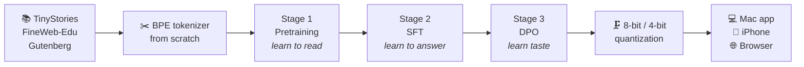

<div align="center">


# Hedwig

**A storytelling language model built from scratch, from zero knobs to 287 million, for under $3.**

Pure PyTorch. No Hugging Face Trainer, no Lightning, no shortcuts. Every step of a modern LLM pipeline is written by hand and measured: tokenizer, pretraining, chat fine-tuning, preference tuning, quantization, and on-device apps.

[**▶ Try it in your browser**](https://huggingface.co/spaces/ansarbuilds/hedwig-demo) ·
[**🎬 Watch the films**](https://ansarbuilds.github.io/hedwig/how-hedwig-learns.html#lesson-1) ·
[**🧠 How Hedwig learns**](https://ansarbuilds.github.io/hedwig/) ·
[**🤗 Weights**](https://huggingface.co/ansarbuilds/hedwig-300m)


</div>

---

## 🎬 The film

<div align="center">
<a href="https://ansarbuilds.github.io/hedwig/how-hedwig-learns.html#lesson-1"></a>
<br><sub>Clips from the launch film, made in code with <a href="film/">Remotion</a>. Click to watch the full film with sound, plus the storybook short <i>Pip and the Lost Key</i>.</sub>
</div>

## ✨ What Hedwig writes

```text
🧑 You:    Tell me a story where a little girl named Lily finds a shiny key in the garden.

🦉 Hedwig (286.7M):
Once upon a time, there was a little girl named Lily. She loved to play outside in the
sunshine with her toys. One day, she found a shiny key on the ground and picked it up.
It sparkled in the sun and she thought it would be fun to keep it forever...
```

The same 12 prompts run on all three sizes, side by side, in [**Story Showdown**](docs/STORY_SHOWDOWN.md).

## 📈 Three generations

| | 🐣 **Mac Hedwig** | ☁️ **Cloud Hedwig** | 🦉 **Flagship Hedwig** |
|---|---:|---:|---:|
| Knobs (parameters) | 13.8M | 97.6M | **286.7M** |
| Layers × width | 6 × 384 | 12 × 768 | 20 × 1024 |
| Vocabulary | 4,096 | 8,192 | 16,384 |
| Trained on | MacBook Air M4 | 1× A40 | 1× RTX 4090 |
| Cost | **$0.00** | $0.65 | $1.70 |
| Chat loss (Stage 2) | 1.438 | 1.336 | 1.341 |
| Preference win rate (Stage 3) | 92.5% | 96.7% | **98.3%** |
| 4-bit size | **7.9 MB** | 55.2 MB | 161.9 MB |

> Loss numbers only compare fairly within one column. Each size uses a different vocabulary, so judge across sizes by reading the [stories](docs/STORY_SHOWDOWN.md).

For scale: GPT-2 small (2019) is about 124 million knobs, and GPT-3 is about 175 billion. Hedwig has read children's stories, educational web pages and 10 public-domain novels.

## 🧠 How it's built



| Piece | What it does | File |
|---|---|---|
| Tokenizer | Word-chunked byte-pair encoding, 3.87 characters per piece | [`tokenizer.py`](tokenizer.py) |
| Transformer | RoPE, RMSNorm, SwiGLU, bf16 autocast, fused attention | [`tinygpt.py`](tinygpt.py) |
| Stage 2 · SFT | Instruction → story pairs, with prompt tokens masked out of the loss | [`sft.py`](sft.py) |
| Stage 3 · DPO | Chosen 👍 vs rejected 👎 stories, with a fluency anchor | [`dpo.py`](dpo.py) |
| Quantization | 8-bit and packed 4-bit, written from scratch | [`quantize.py`](quantize.py) |
| Mac app | Offline chat UI with word streaming and 🔬 Brain X-Ray | [`app.py`](app.py) |
| Browser | Plain-JavaScript inference, matches PyTorch 40/40 pieces | [`web/`](web/) |
| iPhone | Core ML export, matches PyTorch 30/30 pieces | [`export_iphone.py`](export_iphone.py), [`ios/`](ios/) |
| Cloud | One-command, resumable GPU pipeline | [`cloud_train.sh`](cloud_train.sh) |

<details>
<summary><b>🧪 Side experiments</b> (Mixture-of-Experts, distillation, SSD streaming, MLX, French)</summary>

| Experiment | Result | File |
|---|---|---|
| Mixture-of-Experts | 8 experts, top-2: 26.2M total / 11.6M active, loss 2.461 → 1.966 | [`moe.py`](moe.py) |
| Distillation | 13.8M teacher → 3.4M "Baby Hedwig" (6.8 MB), loss 7.602 → 2.521 | [`distill.py`](distill.py) |
| SSD streaming | One layer at a time: 52.9 → 18.8 MB in memory, 108 → 33 tok/s | [`ssd_runner.py`](ssd_runner.py) |
| Apple MLX | Training step 596 → 99 ms, generation 635 → 832 tok/s | [`mlx_bench.py`](mlx_bench.py) |
| French Hedwig | 2.56M knobs on Dumas and Verne, val 7.776 → 3.541 | [`lang_hedwig.py`](lang_hedwig.py) |

</details>

## 🚀 Run it

```bash
# 1. Make a private Python box for Hedwig and install its tools
python3.12 -m venv .venv && .venv/bin/pip install -r requirements.txt

# 2. (Optional) Download the bigger brains from Hugging Face
.venv/bin/python download_brains.py 97m      # 55 MB
.venv/bin/python download_brains.py 300m     # 162 MB

# 3. Open the offline chat app at http://127.0.0.1:8000
.venv/bin/python app.py

# Or ask for one story in the terminal
.venv/bin/python dpo.py talk "Write a short story about a dragon and a castle."
```

<details>
<summary><b>Train it yourself</b></summary>

```bash
.venv/bin/python prepare_data.py     # download stories + books, train the tokenizer, write data/*.bin
.venv/bin/python tinygpt.py train    # Stage 1: learn to read
.venv/bin/python sft.py train        # Stage 2: learn to answer
.venv/bin/python dpo.py train        # Stage 3: learn taste
.venv/bin/python quantize.py         # shrink to 8-bit and 4-bit
bash cloud_train.sh --dry-run        # rehearse the cloud pipeline locally (2 steps)
bash cloud_train.sh --300m           # on a rented GPU: train the 286.7M flagship
```

</details>

## 📚 Read more

- [**LEARNINGS.md**](docs/LEARNINGS.md): every concept, with measured before/after numbers
- [**STORY_SHOWDOWN.md**](docs/STORY_SHOWDOWN.md): 14M vs 97.6M vs 286.7M on the same prompts
- [**CLOUD_GPU_100.md**](docs/CLOUD_GPU_100.md): how the cloud runs were done for $2.45
- [**ROADMAP.md**](docs/ROADMAP.md): what's next
- [**How Hedwig Learns**](https://ansarbuilds.github.io/hedwig/): interactive visual guide with both films
- [**movie/**](movie/): *Pip and the Lost Key*, a short storybook film written by Hedwig

## 🙏 Data and credits

Trained only on legally usable text: [TinyStories](https://huggingface.co/datasets/roneneldan/TinyStories) and TinyStories-Instruct, [FineWeb-Edu](https://huggingface.co/datasets/HuggingFaceFW/fineweb-edu), [Grammarly CoEdIT](https://huggingface.co/datasets/grammarly/coedit) (Apache-2.0), and public-domain books from [Project Gutenberg](https://www.gutenberg.org/). No outputs from closed commercial models.

Inspired by Andrej Karpathy's [nanoGPT](https://github.com/karpathy/nanoGPT) and [nanochat](https://github.com/karpathy/nanochat).

Code is released under the [MIT License](LICENSE).
