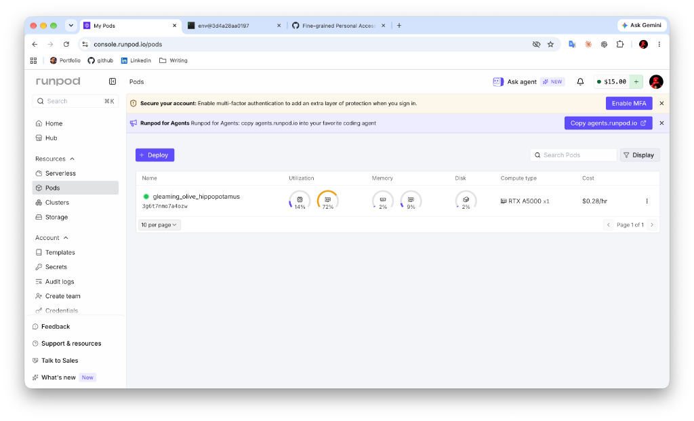
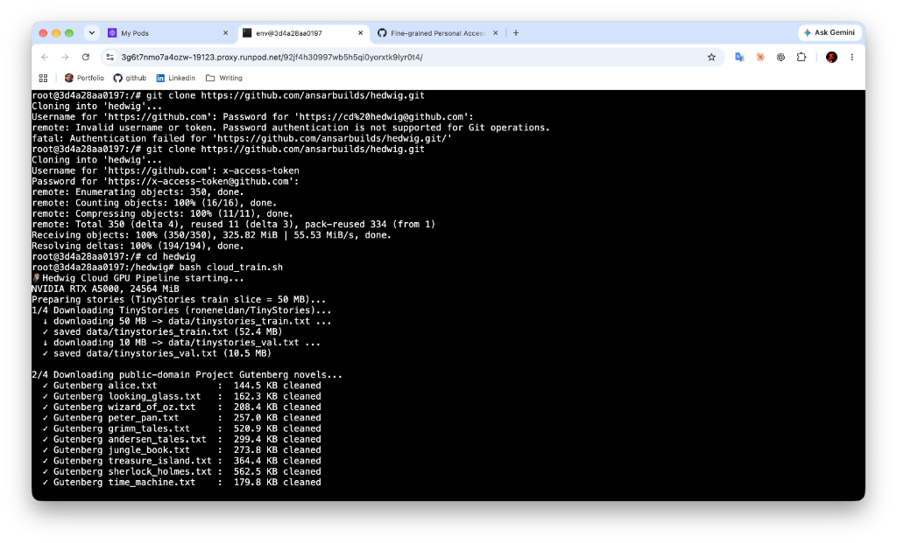

# Spending $100 on cloud GPUs to learn (Actual spend: $2.45)

We budgeted **$100** (deposited **$15.00** on RunPod) and ended up building three complete cloud brains for **$2.45 total**, leaving **~$12.55** in credit.

## Why renting GPUs was 26× faster than the MacBook Air M4

Training FLOPs scale as `6 × knobs × tokens`. On a fanless MacBook Air M4 (8-core laptop GPU), training throttles from `~66s` to `~110s` per 250 steps as the chip heats up, so a 100M+ model takes **weeks**. On a rented NVIDIA data-center GPU, the exact same 50 MB lesson (`13.8M` knobs, 3,000 steps) dropped from **~59 minutes on M4** to **135 seconds on one RTX A5000 (`26× faster`)** for four concrete hardware reasons:

1. **Thousands of Tensor Cores:** Purpose-built matrix multiplication units executing `bfloat16` math in parallel every clock cycle.
2. **Native CUDA FlashAttention:** `F.scaled_dot_product_attention` runs fused FlashAttention kernels directly in fast on-chip SRAM instead of writing full `T × T` attention matrices to memory.
3. **High-Bandwidth Dedicated VRAM:** `48 GB` on an A40 and `24 GB` on an RTX 4090 push hundreds of GB/s straight to compute cores without sharing memory bandwidth with macOS.
4. **Active Data-Center Cooling:** Runs at 100% power for hours with zero thermal throttling.

## How Hedwig's 1 GPU compares to GPT & Claude clusters

Hedwig uses the same Transformer + 3-stage recipe (`Pretrain → SFT → DPO/RLHF`). Frontier models aren't running a completely different algorithm — they scale the exact same loop across **10,000–100,000+ GPUs** connected via NVLink/InfiniBand so they can read **20–40+ tokens per knob** across trillions of web pages, code, and books:

| Model | Knobs | GPUs Used | Tokens Read | Tokens / Knob | Time | Cost (est.) |
|---|---:|---|---:|---:|---:|---:|
| **Mac Hedwig** | `13.8M` | 1× MacBook Air M4 | `~125M` | `~9.0` | ~3 hrs | **$0.00** |
| **Cloud Hedwig** | `97.6M` | 1× NVIDIA A40 (`48 GB`) | `~164M` | `~1.7` | 66 min | **$0.65** |
| **Flagship Hedwig** | `286.7M` | 1× NVIDIA RTX 4090 (`24 GB`) | `~205M` | `~0.7` | 115 min | **$1.70** |
| **GPT-2 Small** *(2019)* | `124M` | 32× Cloud TPU v3 | `~10B` | `~80` | Days | `~$1k–$5k` |
| **GPT-3** *(2020)* | `175B` | ~1,000–10,000× V100 | `~300B` | `~1.7` | Weeks | `~$4.6M` |
| **Llama 3 405B** *(2024)* | `405B` | **16,384× NVIDIA H100** | `15.6T` | `~38.5` | ~54 days | `~$50M+` |
| **GPT-4/5 · Claude Opus** | `1T+` *(est.)* | **10,000–100,000+ H100/B200** | `10T–20T+` | `~20+` + deep RL | Months | `$50M–$500M+` |

---

## Completed Cloud Runs (Measured, 20 Nov 2026)

| Run | GPU & Rate | Duration | Actual Cost | Model & Vocab | Measured Scores | Local Copy / HF Backup |
|---|---|---|---|---|---|---|
| **1. Smoke Test** (`bash cloud_train.sh`) | 1× RTX A5000 (`$0.28/hr`) | ~4 min total (`135s` pretrain) | **`~$0.10`** | `13.8M` (`4,096` BPE, 50 MB) | Stage 1 `2.100`, SFT `1.758`, DPO `91.7%` | `cloud_brains/` (local) |
| **2. Cloud Hedwig** (`bash cloud_train.sh --124m`) | 1× NVIDIA A40 (`$0.59/hr`) | ~66 min (`57m` pretrain) | **`~$0.65`** | **`97.6M`** (`8,192` BPE, 614 MB + CoEdIT) | Stage 1 `2.619`, SFT **`1.336`**, DPO **`1.235` (`96.7%` peak)**, 4-bit `55.2 MB` | `cloud_brains_97m/` · `ansarbuilds/hedwig-97m` |
| **3. Flagship Hedwig** (`bash cloud_train.sh --300m`) | 1× RTX 4090 (`$0.89/hr`) | ~115 min | **`~$1.70`** | **`286.7M`** (`16,384` BPE, 512 ctx, 1.22 GB + 30k CoEdIT) | Stage 1 `2.998`, SFT `1.341`, DPO **`1.200` (`98.3%` win)**, 4-bit `161.9 MB` | `cloud_brains_300m/` · `ansarbuilds/hedwig-300m` |
| **Total** | | **~3 hours** | **`$2.45`** | | | |

---

## How renting safely works (and why zero minutes were wasted)

1. **Always rehearse locally first:** `bash cloud_train.sh --dry-run` copies the scripts into `dry_run/` and trains for 2 steps on 4 MB (`92 s` on M4), verifying data prep, checkpoint saving, and `--resume` without touching real Mac weights or spending cloud money.
2. **Providers & rough rates (late 2026):** RunPod (used here: RTX A5000 `$0.28/hr`, A40 `$0.59/hr`, RTX 4090 `$0.89/hr`), Lambda (`H100 ~$2–4/hr`, `8×H100 ~$16–30/hr`), Vast.ai, Google Colab.
3. **Copy results before terminating:** Transfer weights via `scp` / Jupyter / `upload_hf.py`, then press **Stop** (`$0.00/hr`) and **Terminate** so billing stops completely.




## Safety checklist
- [x] Code rehearsed locally on tiny config (`bash cloud_train.sh --dry-run`, 92 s, real brains untouched)
- [x] Atomic `.tmp` checkpoint saves + automatic resume (`--fresh` is the only flag that wipes saves)
- [x] Weights downloaded locally (`cloud_brains*/`) and backed up to Hugging Face (`ansarbuilds/hedwig-97m`, `ansarbuilds/hedwig-300m`)
- [x] Pods stopped/terminated (`$0.00/hr`), spend **$2.45 / $15.00** deposited
- [x] Temporary fine-grained read-only GitHub token (`hedwig-cloud`) used only during cloud clone and revoked afterward

## Useful commands
```bash
# On the Mac, before spending anything (writes only inside dry_run/)
bash cloud_train.sh --dry-run

# On a rented NVIDIA GPU
git clone https://github.com/ansarbuilds/hedwig.git && cd hedwig
bash cloud_train.sh           # 13.8M smoke test
bash cloud_train.sh --124m    # 97.6M knobs (8k vocab, 614 MB + CoEdIT)
bash cloud_train.sh --300m    # 286.7M flagship (16k vocab, 512 ctx, 1.22 GB + 30k CoEdIT)
bash cloud_train.sh --fresh   # wipe checkpoints and prepared data to restart from step 0
```
